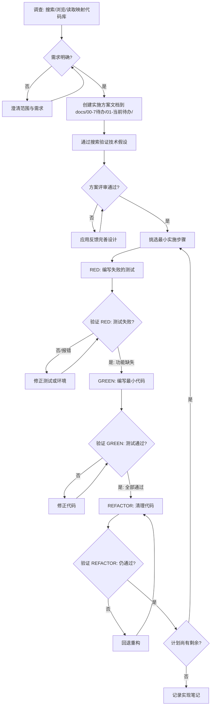

## 工作协议 (Working Agreement)

本技能在涉及核心致死路径与关键状态机契约的开发与重构任务中按需调用。纯文档、UI 组件界面开发、常规页面改动及普通 Bug 排查场景严格免除繁琐单测流程。

### 核心测试哲学：抓大放小（放弃防御性完美主义）

```
只测“主干契约”和“致死路径”，放弃防御性完美主义。
```

- **放弃繁琐组件单测**：
  - 严禁对普通的 UI 组件、页面排版、样式交互堆砌繁琐易碎的组件级单测；
  - 杜绝“删掉已有代码强制补单测”的教条主义；
  - 非核心的 UI 视觉瑕疵、偶发样式和极端罕见边界，采取真实业务踩坑后再行针对性修复的策略，不做过度前置防御。
- **少而精：跑通核心业务流**：
  - 投入核心精力编写少量的端到端自动化脚本（如 Playwright E2E）或高价值集成脚本，把最核心的业务流跑通：
    1. **核心状态机流转**（工作流节点执行生命周期、两阶段意图路由命令派发、SSE 事件物化）；
    2. **关键交易与数据落库**（支付与订单流转、案卷材料解析物化落库、MinIO 与元数据双轨持久化）；
    3. **主干契约一致性**（前后端 OpenAPI 强契约与跨端通信）。

### 核心底线 (Non-negotiables)

1. **调查优先**：在做任何改动前，先理解当前状态（应用状态、执行结果、用户输入、日志）。通过搜索、阅读代码、浏览目录结构等手段进行代码库映射。
2. **未经确认不得更改需求**：如果需求不明确，请提出澄清问题。在更改/添加/解释需求之前，必须获得明确确认。
3. **在实现前为复杂任务创建`实施方案`文档**：
   - 输出到 `docs/00-7待办/01-当前待办/`（或当前分层待办）。
   - 文件名格式：`<编号>-<中文主题>-实施方案.md`。
4. **验证技术假设**：当你依赖 API/包/技术细节时，必须搜索确认签名、版本行为及弃用信息。
5. **主干契约驱动**：改动核心致死路径时，确保有主干断言覆盖关键状态机或数据落库结果，避免破坏主干业务。

### 测试重心分布 (Pragmatic Testing Model)

放弃教条主义金字塔，采取务实的“抓大放小”测试模型：

```
       /\
      /  \  高价值端到端 / 集成测试 (Playwright E2E / 核心工作流)
     /    \  - 跑通核心状态机流转、支付、案卷解析落库等致死路径
    /------\  - 【主力抓手，少而精，守护关键业务流】
   /        \
  /   底层纯   \  核心基础设施 / 适配器测试 (Vitest / Pytest)
 /   逻辑/适配器 \ - 仅针对 custom-fetch-adapter、纯算法纯逻辑
/----------------\ - 【严禁在业务 UI 组件层堆砌繁琐单测】
```

### 测试执行频率与范围底线 (Test Execution Limits)
- **增量精准**：日常开发严禁频繁全量跑测。仅针对当前关联的核心用例进行验证。
- **非核心不强求**：非关键 UI 与轻量展示逻辑，以本地静态检查（typecheck、lint）通过为准，不强加自动化测试要求。

### Red-Green-Refactor 循环（带强制验证）

```
RED → 验证失败 → GREEN → 验证通过 → REFACTOR → 验证仍通过 → 下一个
```

#### RED - 写一个最小的失败测试

写一个测试，展示你期望的行为。

**好的测试：**
```python
def test_retries_failed_operation_3_times():
    attempts = 0
    def operation():
        nonlocal attempts
        attempts += 1
        if attempts < 3:
            raise ValueError("fail")
        return "success"

    result = retry_operation(operation)

    assert result == "success"
    assert attempts == 3
```
名字清晰，测试真实行为，只测一件事。

**坏的测试：**
```python
def test_retry_works():
    mock_func = Mock(side_effect=[ValueError, ValueError, "success"])
    result = retry_operation(mock_func)
    assert mock_func.call_count == 3
```
名字模糊，测的是 mock 而不是代码。

**要求：**
- 一个行为
- 清晰的名字
- 真实代码（除非万不得已才用 mock）

#### 验证 RED - 看到它失败（强制，绝不跳过）

```bash
python -m pytest tests/test_xxx.py::test_specific_function -v  # 强制要求：仅运行相关的单个测试
```

确认：
- 测试是**失败**（不是报错）
- 失败信息是预期的
- 失败原因是功能缺失（不是拼写错误）

**测试通过了？** 你在测已有行为。修正测试。
**测试报错了？** 修正错误，重跑直到它正确失败。

#### GREEN - 写最简代码

写最简单的代码让测试通过。

**好的实现：**
```python
def retry_operation(fn, max_retries=3):
    for i in range(max_retries):
        try:
            return fn()
        except Exception:
            if i == max_retries - 1:
                raise
```
刚好让测试通过。

**坏的实现：**
```python
def retry_operation(fn, max_retries=3, backoff="linear", on_retry=None):
    # YAGNI - 测试没要求这些
```
过度工程。

不要加功能、重构其他代码、或"改进"超出测试范围的东西。

#### 验证 GREEN - 看到它通过（强制）

```bash
python -m pytest tests/test_xxx.py::test_specific_function -v  # 强制要求：仅运行相关的单个测试
```

确认：
- 测试通过
- 其他测试也通过
- 输出干净（没有错误、警告）

**测试失败？** 改代码，不改测试。
**其他测试失败？** 立刻修。

#### REFACTOR - 清理

只在绿色之后：
- 消除重复
- 改善命名
- 提取辅助函数

保持测试绿色。不要加行为。

#### 重复

为下一个功能写下下一个失败测试。

### 测试替身 (Test Doubles)

根据场景选择合适的测试替身：

| 类型 | 用途 | 示例 |
|------|------|------|
| **Stub** | 提供预定义的返回值 | `mock.patch('requests.get', return_value=mock_response)` |
| **Mock** | 验证方法调用和参数 | `assert mock_func.called_once_with(expected_args)` |
| **Spy** | 记录方法调用历史 | `spy = mocket.spy(requests, 'get')` |
| **Fake** | 简化的功能实现 | `InMemoryDatabase()` |

**选择指南**：
- 简单返回值 → Stub
- 验证交互行为 → Mock
- 记录调用历史 → Spy
- 需要真实但轻量的实现 → Fake

### 属性测试 (Property-based Testing)

使用属性测试发现边界情况和意外行为：

```python
# Python: 使用 Hypothesis
from hypothesis import given, strategies as st

@given(st.lists(st.integers()))
def test_sort_returns_sorted_list(lst):
    result = sorted(lst)
    assert result == sorted(result)  # 幂等性
    assert len(result) == len(lst)   # 长度不变
    assert all(x in lst for x in result)  # 元素不变
```

```typescript
// JavaScript/TypeScript: 使用 fast-check
import * as fc from 'fast-check';

fc.assert(
  fc.property(
    fc.array(fc.integer()),
    (arr) => {
      const sorted = [...arr].sort((a, b) => a - b);
      return sorted.every((v, i) => i === 0 || sorted[i - 1] <= v);
    }
  )
);
```

**属性测试原则**：
1. **幂等性**：多次执行结果相同
2. **交换律/结合律**：数学性质验证
3. **逆运算**：编码/解码、序列化/反序列化
4. **边界条件**：空集合、单元素、极大值

### 覆盖率与变异测试

**覆盖率目标**：
- 单元测试覆盖率：≥ 80%
- 集成测试覆盖率：≥ 60%
- 关键业务逻辑：≥ 90%

**变异测试策略**：
```bash
# Python: 使用 pytest-mutagen
pip install pytest-mutagen
pytest --mutate

# 查看变异分数
# 目标：变异分数 ≥ 70%（杀死的变异体比例）
```

**变异测试原则**：
- 如果测试能发现变异，则测试有效
- 如果变异未被发现，说明测试不足
- 关注业务逻辑的变异，忽略样板代码

### 常见借口与反驳

| 借口 | 现实 |
|------|------|
| "太简单了不用测" | 简单代码也会出错。测试只要 30 秒。 |
| "我之后再补测试" | 之后补的测试立刻通过，证明不了任何东西。 |
| "之后补测试能达到同样目标" | 之后补的测试问的是"这代码做了什么？"，TDD 问的是"这代码应该做什么？" |
| "已经手动测过了" | 手动测试是临时的。没有记录，没法重跑。 |
| "删掉 X 小时的工作太浪费了" | 沉没成本。保留未验证的代码才是技术债。 |
| "留着当参考，先写测试" | 你会适配它的。那就是之后补测试。删掉就是删掉。 |
| "需要先探索一下" | 可以。但探索完扔掉，从 TDD 开始。 |
| "测试难写 = 设计有问题" | 听测试的。难测 = 难用。 |
| "TDD 太教条了，我比较务实" | TDD 就是务实：比调试快，比生产事故快。 |
| "手动测试更快" | 手动测试没法证明边界情况。每次改动都得重测。 |
| "现有代码没测试" | 你在改进它。给现有代码加测试。 |

**以上所有借口的正确回应：删掉代码。从 TDD 重新开始。**

### 红旗 - 停下，重新开始

- 代码写在测试之前
- 测试在实现之后才补
- 测试立刻通过
- 说不清测试为什么失败
- 测试是"之后加的"
- 找理由"就这一次"
- "我已经手动测过了"
- "之后补测试能达到同样目标"
- "重要的是精神不是仪式"
- "留着当参考" 或 "适配已有代码"
- "已经花了 X 小时，删掉太浪费"
- "TDD 太教条了，我比较务实"
- "这次不一样因为..."

**以上全部意味着：删掉代码。从 TDD 重新开始。**

### 完成前验证清单

在声称工作完成之前，必须全部打勾：

- [ ] 每个新函数/方法都有测试
- [ ] 每个测试在实现前都看到它失败
- [ ] 每个测试都因预期原因失败（功能缺失，不是拼写错误）
- [ ] 每次只写了最简代码让测试通过
- [ ] 所有测试通过
- [ ] 输出干净（没有错误、警告）
- [ ] 测试用的是真实代码（除非万不得已才用 mock）
- [ ] 边界情况和错误路径都覆盖了

打不齐所有勾？你跳过了 TDD。重新开始。

### 为什么顺序很重要

**"我先实现，之后补测试来验证它能用"**

之后补的测试立刻通过。立刻通过证明不了任何东西：
- 可能测错了东西
- 可能测的是实现而不是行为
- 可能漏掉了你忘记的边界情况
- 你从来没看到它捕获 bug

先写测试迫使你看到测试失败，证明它确实在测东西。

**"我已经手动测了所有边界情况"**

手动测试是临时的。你以为测了所有情况但：
- 没有记录你测了什么
- 代码改了没法重跑
- 压力下容易忘记情况
- "我试的时候能用" ≠ 全面

自动化测试是系统化的。每次运行方式一致。

**"删掉 X 小时的工作太浪费了"**

沉没成本。时间已经花了。你现在的选择：
- 删掉用 TDD 重写（X 小时，高信心）
- 保留之后补测试（30 分钟，低信心，可能有 bug）

"浪费"是保留你不信任的代码。能用但没有真正测试的代码是技术债。

### 卡住了怎么办

| 问题 | 解决方案 |
|------|----------|
| 不知道怎么测 | 写你希望的 API。先写断言。 |
| 测试太复杂 | 设计太复杂。简化接口。 |
| 必须 mock 一切 | 代码耦合太紧。用依赖注入。 |
| 测试设置代码巨大 | 提取辅助函数。还复杂？简化设计。 |

## 逐任务实施方案文档结构（强制要求）

对于每个任务，编写实施方案文档到 `docs/00-7待办/01-当前待办/<编号>-<中文主题>-实施方案.md`，包含以下内容：

1. **现状 (As Is)**：当前的行为/状态。
2. **目标 (To Be)**：更改后期望的行为/状态。
3. **需求 (Requirements)**：功能需求（编号列出）。
4. **验收标准 (Acceptance Criteria)**：为每个功能需求添加明确的验收标准（BDD 风格）。
5. **测试计划 (Testing Plan)**：测试策略 + 案例（遵循 TDD 最佳实践）。
6. **实施计划 (Implementation Plan)**：最小的顺序代码更改及对应的测试方法。

### BDD 风格验收标准

使用 Given-When-Then 格式编写验收标准：

```gherkin
# 示例：用户登录功能
Feature: 用户登录
  Scenario: 成功登录
    Given 用户已注册且密码正确
    When 用户输入正确的用户名和密码
    Then 用户被重定向到仪表盘
    And 显示欢迎消息

  Scenario: 密码错误
    Given 用户已注册
    When 用户输入错误的密码
    Then 显示错误消息"密码不正确"
    And 用户保持在登录页面
```

**BDD 验收标准原则**：
- **Given**：前置条件（系统状态、用户角色、数据）
- **When**：触发动作（用户操作、系统事件）
- **Then**：预期结果（系统响应、状态变化、数据验证）
- **And/But**：额外的条件或结果

**实施步骤**：
1. 编写 Gherkin 场景（.feature 文件）
2. 实现步骤定义（Step Definitions）
3. 运行测试验证场景
4. 根据失败编写最小实现
5. 重构直到测试通过

## 工作流（分步指南）

### 1) 调查 (Investigate)

- 通过搜索、代码浏览和读取文件等手段进行代码库映射，理解当前结构与行为。
- 检查仓库结构、相关代码路径、当前行为和现有测试。
- 运行必要的最小命令确认当前状态。
- **识别测试策略**：确定需要哪些类型的测试（单元、集成、E2E）。

### 2) 澄清并确认需求

- 针对模糊之处提问（范围、UX、边界情况、性能）。
- 以具体的、可测试的语言提议需求，并请求明确确认。
- **编写 BDD 验收标准**：使用 Given-When-Then 格式定义验收条件。

### 3) 创建实施方案文档

- 在 `docs/00-7待办/01-当前待办/` 下创建实施方案文档。
- 编写 "现状"、"目标" 和 "功能需求"。
- 搜索获取包、API 的最新文档。
- 将有用发现记录到项目记忆或实施方案文档中。
- 为每个需求添加验收标准、测试计划和详细的实施计划。
- **定义测试替身策略**：确定哪些依赖需要 Mock/Stub/Fake。

### 4) 验证假设

- 通过搜索验证技术假设。
- 如果假设变化，及时更新需求文件并重新确认。
- **验证测试工具**：确认测试框架、覆盖率工具、变异测试工具可用。

### 5) 评审需求

- 邀请对实施方案文档进行逻辑和架构评审。
- 根据反馈更新需求。
- **评审测试策略**：确保测试金字塔平衡，属性测试覆盖关键性质。

### 6) TDD 实现与评审

- 按实施计划顺序执行（先测试，后实现）。
- **严格遵循 Red-Green-Refactor 循环，每步必须验证**：
  1. **RED**：编写失败的测试
  2. **验证 RED**：运行测试，确认失败（不是报错），失败原因是功能缺失
  3. **GREEN**：编写最小代码使测试通过
  4. **验证 GREEN**：运行测试，确认通过，其他测试也通过
  5. **REFACTOR**：重构代码保持测试通过
  6. **验证 REFACTOR**：运行测试，确认仍通过
- 每个步骤完成后，进行代码评审。
- 运行测试确保通过，保持 Diff 简洁，避免无关重构。
- 记录实现注释和设计信息到记忆中。
- **验证测试覆盖率**：确保关键代码路径被覆盖。
- **绝不跳过验证**：没有看到测试失败/通过的证据，就不能声称完成。

### 7) 属性测试补充（可选）

- 对关键业务逻辑编写属性测试。
- 使用 Hypothesis（Python）或 fast-check（JavaScript）生成测试用例。
- 验证幂等性、交换律、逆运算等性质。

### 8) 变异测试验证（可选）

- 运行变异测试验证测试有效性。
- 分析未被杀死的变异体，补充测试用例。
- 目标：变异分数 ≥ 70%。

## 工作流活动图 (Mermaid)



## TDD 模式与最佳实践

### 测试命名规范

```python
# 函数命名：test_<行为>_<场景>_<预期结果>
def test_calculate_discount_when_user_is_vip_returns_20_percent():
    # Arrange
    user = User(is_vip=True)
    order = Order(amount=100)
    
    # Act
    discount = calculate_discount(user, order)
    
    # Assert
    assert discount == 20.0
```

```typescript
// 函数命名：describe + it 模式
describe('calculateDiscount', () => {
  it('should return 20% discount for VIP users', () => {
    // Arrange
    const user = { isVip: true };
    const order = { amount: 100 };
    
    // Act
    const discount = calculateDiscount(user, order);
    
    // Assert
    expect(discount).toBe(20.0);
  });
});
```

### AAA 模式 (Arrange-Act-Assert)

每个测试都应遵循 AAA 模式：

1. **Arrange**：设置测试环境和数据
2. **Act**：执行被测试的操作
3. **Assert**：验证预期结果

### 测试隔离原则

- **独立性**：每个测试应独立运行，不依赖其他测试
- **可重复性**：测试结果应一致，不依赖外部状态
- **快速性**：单元测试应在毫秒级完成
- **自验证**：测试应自动验证结果，无需人工检查

### Mock 使用原则

1. **只 Mock 你拥有的代码**：不要 Mock 第三方库
2. **Mock 边界**：在系统边界（数据库、API、文件系统）使用 Mock
3. **验证行为而非状态**：Mock 应验证方法调用，而不是内部状态
4. **保持 Mock 简单**：Mock 应返回预定义值，不要包含复杂逻辑
5. **E2E API Mock 自动化**：针对前端 E2E 测试（如 Playwright）编写 API Mock 时，强烈建议基于 OpenAPI 规范自动生成类型安全的拦截器骨架代码，禁止凭空手写。

### 测试数据管理

```python
# 使用 Fixture 管理测试数据
@pytest.fixture
def sample_user():
    return User(
        id=1,
        name="Test User",
        email="test@example.com",
        is_vip=True
    )

# 使用 Factory 生成测试数据
class UserFactory:
    @staticmethod
    def create(**kwargs):
        defaults = {
            "id": 1,
            "name": "Test User",
            "email": "test@example.com",
            "is_vip": False
        }
        defaults.update(kwargs)
        return User(**defaults)
```

## 记忆存储建议

- `project_overview.md`：仓库定位、核心架构。
- `suggested_commands.md`：构建/测试常用命令。
- `style_and_conventions.md`：编码规范、常见陷阱。
- `bugs.md`：显著 Bug 记录。
- `test_patterns.md`：测试模式和最佳实践。
- `test_doubles.md`：测试替身使用指南。

## 核心约束与执行标准

### 严格边界与禁止项
- **安全 > 质量 > 速度**：任何全栈决策和代码修改必须遵循此总原则。
- **禁止项**：严禁在未经用户确认的情况下删除核心业务规则。
- **禁止项**：严禁输出虚假或未经测试的配置。

## 思维链引导

在执行复杂步骤、架构设计或遇到歧义时，必须通过 `<thought>` 标签显式输出你的思考过程和逻辑推导，然后再输出最终行动或代码方案。
